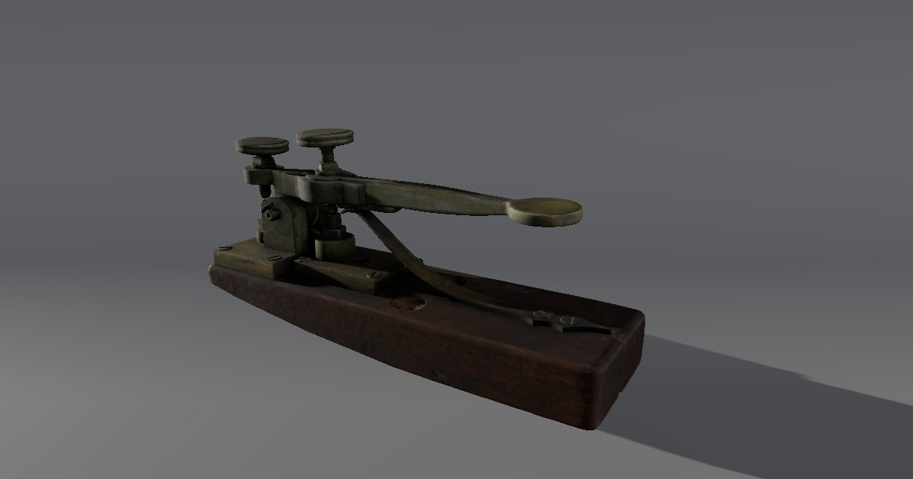

> **Evaluation status:** Automated functional, accessibility and performance testing plus agent-based design reviews are complete. No real learners have tested this yet. No physical phone testing has been done (mobile was checked with device emulation). See `evaluation/METHODS.md`.

# The Object Detective

**Play now:** https://immersive-learning-showcase.vercel.app/play/object-detective/ (pending deployment: available once v1.0.0 is pinned in the showcase)

A draft museum label makes bold claims. You examine **real Smithsonian 3D scans** under raking light, magnify and measure them, corroborate them with the catalog records, and write a corrected label that says what you know and how sure you are.



| | |
|---|---|
| Format | Game: tutorial case + main case, about 35 minutes |
| Audience | Grades 8–12, first-year undergraduates (history, information literacy), online museum visitors |
| Built with | three.js 0.186.1, Vite 8, postprocessing + N8AO, Playwright, axe-core, vitest |
| Objects | 6 CC0 scans from the Smithsonian National Museum of American History (Open Access) |
| Framing | The **Lantern Museum** is fictional. Its staff and documents are fictional and labelled as fictional in the app |

## Trailer
*Placeholder: a captioned trailer of 60 seconds or less will be added here (recorded later by the orchestrator).*

## The problem
Sourcing, corroboration and stating uncertainty are core historical-thinking skills. Students mostly meet artifacts as flat photos with confident labels, so they treat the label as fact and mix up what they *see* with what they *infer*.

## Approach
You are a new evening intern. Each case gives you a fictional draft label with claims to check:

1. **Inspect** the real scans. Points of interest guide you, and each finding needs the right tool: look, magnify, raking light or measure. Classify every statement as **observation** or **inference**, with feedback that explains why.
2. **Archive.** Open the real Smithsonian records and the fictional documents, and source each one: who made it, when, and why.
3. **Evidence board.** Pin evidence to each claim as *supports / contradicts / unclear*, then give a verdict (*confirmed / refuted / can't tell yet*) and a confidence rating.
4. **Label.** Write for the public using sentence starters. Self-check against a 4-criterion rubric and compare with the curator's exemplar. There is no automated grading of free text.
5. **Debrief.** See the expert reasoning path, verdict accuracy, evidence linking, a calibration score and links to the real records.

Then a pre-check / transfer pair: a new object (tangent galvanometer) with no hints.

Evidence in Case 2 includes the **catalog numbers painted or written on the objects themselves** (relay 335.588, coil 309254), which you find with the magnifier and match to the records. It also includes a documented uncertainty: Davenport's motor is a *replacement* for a model destroyed in the 1836 Patent Office fire. One trap is a family story about Joseph Henry, where "can't tell yet" is the honest answer.

## Key design decisions
Full list in [DECISIONS.md](DECISIONS.md).
- Real CC0 scans, with fiction only in the framing (D-01). CC0 status is verified from the Smithsonian API for the record and the 3D media. Proof is in `research/`.
- Raking light, a magnifier with on-demand 4096 px textures, and true-scale measuring: the realism serves as a research tool (D-06, D-07).
- "Can't tell yet" plus confidence and calibration (D-10).
- One decision path for 3D and text mode, which guarantees parity (D-13).
- A scan whose size does not match its record is never measured (D-11).

## Realism and cinematics: design rationale
High realism is used only where the detail **is** the evidence: the scans themselves (true scale, real textures), a physically based raking light, and the magnifier. The gallery is medium realism and dims during inspection. There are no characters, particles, bloom or DOF. Realistic details help learning when they are task-relevant and can overwhelm when they are not ([PMC11269326](https://pmc.ncbi.nlm.nih.gov/articles/PMC11269326/)). See [design/realism-matrix.md](design/realism-matrix.md).
Cinematics: **32 s of a 90 s budget**. S1 "After hours" (orient, 18 s) and S2 "The reveal" (your label in the case, 14 s, optional after the debrief). Both are captioned and skippable from the first frame, and become still frames under reduced motion ([design/shot-list.md](design/shot-list.md)).

## Evidence and evaluation
See [evaluation/METHODS.md](evaluation/METHODS.md). In summary: 42 unit tests (including a fact audit against the Smithsonian records and case solvability), 14 scripted Playwright tests (both cases solvable in 3D, Case 2 also in text mode, plus one mobile emulation), axe with zero critical/serious issues in every state, and the sub-path test at `/play/object-detective/`. No learner data exists.

## Play it your way
- **Text mode** (header button): the same decisions, using photos rendered from the scans, audio-description-style text and transcriptions.
- **Keyboard:** everything works by keyboard. Keys are shown and remappable (Menu → Controls and keys). Arrow keys turn and tilt, `=`/`-` zoom, `F` turns the object over, `R` toggles the raking light (`[` `]` `,` `.` adjust it), `M`/`N` the magnifier, `T` measures, `G` true size.
- **Reduced motion:** follows your OS setting, plus a toggle in Settings.
- **Quality presets:** Low / Medium / High / Ultra, auto-selected and overridable. Text size and high contrast are in Settings.

## Accessibility
[design/accessibility-plan.md](design/accessibility-plan.md). The HTML overlay was tested with axe-core. Screen-reader testing with real assistive technology has not been done. Full WCAG validation needs manual testing with assistive technologies and an expert review.

## System requirements and known limitations
- Current Chrome, Edge, Firefox or Safari with WebGL2. Without WebGL2 the game opens in text mode automatically.
- First load is about 5–7 MB (code, decoders, lighting, textures, first scan). Each magnifier hi-res scan is an optional 7–10 MB extra.
- No physical phone testing. The tangent galvanometer scan is not at verified true scale, so it is used for photos only.

## For teachers
[design/teacher-guide.md](design/teacher-guide.md): a 40-minute plan, discussion questions and an answer key.

## Run locally
```bash
npm ci
npx playwright install chromium
npm run dev            # http://localhost:5174
npm test               # unit tests (fact audit needs data/raw: run scripts/fetch-smithsonian-models.mjs)
VITE_TEST_HOOKS=1 npm run build && npx playwright test tests/functional.spec.js tests/a11y.spec.js
npm run build && SLUG=object-detective npx playwright test tests/sub-path.spec.js
node scripts/validate-showcase.mjs 1.0.0
```
Asset pipeline: `scripts/fetch-smithsonian-models.mjs` → `prepare-models.mjs`, `prepare-textures.sh`, `render-views.mjs public/assets/photos`, `render-poster.mjs`, `capture-cc0-proof.mjs`.

## Next steps
- Agent reviews and the revisions they produce, then a trailer and the `v1.0.0` tag.
- Real playtests using `evaluation/human-protocol/`.
- More cases as data, for example other CC0 NMAH electricity objects.

## License
Code: MIT ([LICENSE](LICENSE)). Content: CC BY 4.0 ([LICENSE-CONTENT](LICENSE-CONTENT)). Smithsonian scans and record metadata: CC0. Full credits are in [ATTRIBUTION.md](ATTRIBUTION.md).
